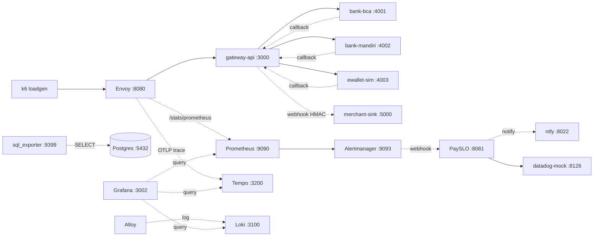

# PaySLO Lab

PaySLO Lab is a fully local simulation of a payment gateway. It exists to onboard site reliability
engineers and to provide a realistic test bed for **PaySLO**, an open-source SLO-as-code tool with
multi-provider support, incident management, and runbook automation.

The entire stack runs on a laptop with Docker Compose. No cloud account, Kubernetes cluster, or real
Datadog tenant is required. All data is synthetic.

> **Not for production.** Every port is bound to `127.0.0.1`, every credential is marked `lab-only`,
> and all data is generated. There is no production-grade authentication, no Kubernetes, no cloud,
> and no real Datadog instance (`datadog-mock` reproduces a subset of the API). Do not run this lab on
> a public server, do not enter real data, and do not expose its ports.

Step-by-step instructions, from prerequisites to a completed scenario, are in
[docs/RUNNING.md](docs/RUNNING.md).

## Quick start

The three commands below require Docker Compose v2 and `make`. They use prebuilt images and do not
compile anything:

```sh
PAYSLO_IMAGE_TAG=v0.1.0 make up-prebuilt
make e2e        # one payment -> bank callback -> merchant webhook through Envoy
make down
```

### Trainee workflow (command line)

Once the stack is running:

```sh
cargo run -p lab -- scenario start 01   # or: ./target/debug/lab scenario start 01
# detect the incident through alerts, mitigate, for example: lab routing disable bca
cargo run -p lab -- verify 01
cargo run -p lab -- scenario stop 01
```

### Trainee workflow (Lab Console)

The Lab Console is a local web interface intended for trainees who prefer not to work from the command
line:

```sh
make up-lite    # or: PAYSLO_IMAGE_TAG=v0.1.0 make up-prebuilt
make ui-build   # once; embeds the UI into the `lab serve` binary
make serve      # open http://127.0.0.1:8088
```

Create a payment under **Payments** and follow **Incidents** (alert, runbook, approval). Curriculum
scenarios are still started and verified through the `lab` CLI; the `/scenarios` route in the UI is a
placeholder (see [docs/BACKLOG.md](docs/BACKLOG.md)).

### Local build (contributors)

```sh
make up-lite    # build locally and start default+traffic+obs+payslo
make smoke      # full pipeline: up -> traffic -> apply SLO ->
                # scenario 01 solver -> incident + ntfy + resolved -> down
                # approximately 12 to 75 minutes, depending on burn-rate drain
make down
```

Prebuilt images are published to GHCR for every `v*` git tag by the `release.yml` workflow. Forks must
override the registry with `PAYSLO_REGISTRY=ghcr.io/<org> make up-prebuilt` (see
[docs/VERSIONS.md](docs/VERSIONS.md)). The default tag is `v0.1.0`.

## Architecture



The money flow follows principle P2 from `AGENTS.MD`: an HTTP 200 from the gateway does not mean the
payment succeeded. The final status (`SUCCESS`, `FAILED`, or `EXPIRED`) arrives through the bank
callback.

## Services and endpoints

All endpoints are bound to `127.0.0.1`. Run `make open` to print the current list.

| Service | URL | Credentials |
|---|---|---|
| gateway-api | `:3000/healthz`, `:3000/readyz` | None |
| gateway admin | `:3001` (loopback only, not through Envoy) | None |
| Envoy | `:8080` (traffic), `:9901` (admin and stats) | None |
| merchant-sink | `:5000/state` | None |
| bank-sim | `:4001` (bca), `:4002` (mandiri), `:4003` (ewallet) | None |
| Prometheus | `:9090` | None |
| Alertmanager | `:9093` | None |
| Grafana | `:3002` | `admin` / `lab-only-grafana` (anonymous access is Viewer) |
| sql_exporter | `:9399/metrics` | Database role `lab_ro` (read-only) |
| Loki | `:3100` | None |
| Tempo | `:3200` | None |
| PaySLO | `:8081/incidents` | None |
| datadog-mock | `:8126` | `DD-API-KEY` header (lab value) |
| ntfy topic | `:8022/payslo-lab` | No authentication (lab-only, loopback only) |

## Lab Console

The Lab Console is a local web dashboard at `127.0.0.1:8088`, served by the Go binary `lab serve` with
an embedded React build.


The screenshot shows Mission Control from `lab serve --demo` in the dark theme. Full-page snapshots for
both themes are stored in `ui/e2e/visual.spec.ts-snapshots/`.

```sh
make ui-install   # npm ci with exact pins
make ui-dev       # Vite on :5173 (use --dev-proxy for the API)
make ui-build     # tsc + vite -> ui/dist, then copy into the Go embed directory
make ui-test      # tsc + eslint + vitest + prettier check
make ui-e2e       # Playwright against lab serve --demo (axe, a11y, visual, security)
make ui-audit     # npm audit, licenses, bundle budget, gofmt, go vet
make ui-perf      # bundle budget and FCP/DCL (set PERF_SOAK_SECONDS for the SSE soak)
make serve        # live API and embedded UI on :8088
make serve-demo   # deterministic fixtures, no Docker required
```

Available pages: **Mission Control**, Architecture Map, **Payments**, **Chaos and Control**,
**SLO Center**, **Incidents**, **Mentor** (PIN protected), **Learn** (curriculum), **Observability**
(Grafana, Prometheus, Alertmanager, ntfy), and **Settings and Diagnostics**. Remaining routes are
placeholders.

The trainee interacts only with `lab serve`. Mutations require `X-Lab-Token` and `X-Lab-Actor` and are
recorded in the append-only audit log `payslo-workspace/lab-audit.jsonl`. Live SLO operations require
`DD_API_KEY=lab-only-dd-api-key` on the host (`make serve`) for the datadog-mock connection.

Accessibility work from U8 includes full keyboard operation, `aria-live` regions for incidents and
approvals, `prefers-reduced-motion` support, and no horizontal overflow at 200% zoom.

UI quality gates run in CI (`.github/workflows/ci.yml`) and locally: strict `tsc --noEmit`, ESLint
(with `jsx-a11y` and a ban on hardcoded strings), Prettier, Vitest (at least 80% coverage of core
logic), Playwright (accessibility and axe, visual regression, compatibility, security), `npm audit`
with license checks (`ui/scripts/check-licenses.mjs`), and a bundle budget
(`ui/scripts/check-bundle.mjs`: initial JavaScript at most 350 KB gzip). Measured values (bundle size,
FCP/DCL, one-hour SSE soak, axe matrix) are recorded in [docs/UI-SPEC.md](docs/UI-SPEC.md).

The API contract lives in `api/openapi.yaml`. TypeScript types are generated into `ui/src/api/`. The UI
specification is [docs/UI-SPEC.md](docs/UI-SPEC.md).

## PaySLO CLI

```sh
cargo run -p payslo-cli -- validate payslo-workspace/slo --workspace payslo-workspace
cargo run -p payslo-cli -- render payslo-workspace/slo --workspace payslo-workspace --out payslo-workspace/generated
cargo run -p payslo-cli -- plan payslo-workspace/slo --workspace payslo-workspace
export DD_API_KEY=lab-only-dd-api-key
cargo run -p payslo-cli -- apply payslo-workspace/slo --workspace payslo-workspace
cargo run -p payslo-cli -- drift --workspace payslo-workspace
cargo run -p payslo-cli -- capabilities
```

Templates are in `payslo/templates/` (three lab SLOs plus one production-style 30-day example that is
render-only). Connection settings are in `payslo-workspace/connections.yml`. The capability matrix is
in `payslo/CAPABILITIES.md`.

## Trainee workflow

```sh
cargo run -p lab -- scenario list
cargo run -p lab -- scenario start 01
cargo run -p lab -- hint 01
cargo run -p lab -- routing disable bca
cargo run -p lab -- answer diagnosis "provider bca down ..."
cargo run -p lab -- verify 01
cargo run -p lab -- scenario stop 01
```

The five-day curriculum is in [curriculum/](curriculum/). The mentor guide is
[docs/mentor-guide.md](docs/mentor-guide.md). If you get stuck, see
[docs/troubleshooting.md](docs/troubleshooting.md). Version pins and upgrade procedures are in
[docs/VERSIONS.md](docs/VERSIONS.md). Beginner-friendly issues are listed in
[docs/GOOD_FIRST_ISSUES.md](docs/GOOD_FIRST_ISSUES.md).

## Resource requirements

- Laptop with 4 CPUs and 8 GB RAM; Linux, macOS, or Windows with WSL2; amd64 and arm64.
- The `up-lite` profile, measured on 2026-10-15 with `docker stats --no-stream` on arm64:

| Service | Memory used / limit |
|---|---|
| postgres | ~56 MB / 256 MB |
| prometheus | ~58 MB / 256 MB |
| grafana | ~73 MB / 256 MB |
| envoy | ~17 MB / 128 MB |
| sql-exporter | ~17 MB / 64 MB |
| alertmanager | ~27 MB / 64 MB |
| ntfy | ~14 MB / 64 MB |
| loadgen (k6) | ~11 MB / 128 MB |
| gateway-api | ~2 MB / 128 MB |
| bank-sim (three instances) | ~1 MB / 64 MB each |
| merchant-sink | ~2.5 MB / 64 MB |
| payslo | ~1 MB / 128 MB |
| datadog-mock | ~1 MB / 64 MB |
| **Total for up-lite** | **~280 MB**, well below the 5 GB limit in principle P6 |
| Additional `obs-full` services (Loki ~45 MB, Tempo up to 384 MB, Alloy) | ~200 MB when enabled |

Static musl `scratch` images, measured on 2026-10-15 on arm64: gateway-api 14.5 MB, bank-sim 11.3 MB,
merchant-sink 5.2 MB, payslo 19.3 MB, datadog-mock 5.4 MB. The upstream ntfy image is 118 MB.

## Build time and memory guidance

Measured on 2026-10-14 with Colima at 4 CPUs and 8 GB on arm64. The Dockerfile did not change in phase 8.

| Scenario | Time |
|---|---|
| Clean build (cold cache, all musl release dependencies) | about 7 minutes |
| Incremental build (one Rust file changed, Chef cache reused) | about 50 seconds |
| No changes (full cache) | about 1 second |

- The `Dockerfile` uses `cargo-chef` (planner, cacher, builder) with a single builder stage
  (`cargo build --release --workspace`), followed by one runtime stage per binary.
- `CARGO_BUILD_JOBS=2` is set in the `Dockerfile` to avoid out-of-memory failures on 8 GB machines.
  Do not raise it on an 8 GB laptop. On a 16 GB CI runner, `CARGO_BUILD_JOBS=4` is acceptable.
  Example: `CARGO_BUILD_JOBS=2 docker compose --profile traffic --profile obs --profile payslo up -d --build`.
- Provide at least 6 GB to Docker Desktop or Colima when the build and the stack run at the same time.
- CI uses `Swatinem/rust-cache` for Cargo and `cache-from`/`cache-to: type=gha` for Docker layers to
  keep builds incremental.

## Compose profiles

| Profile | Services | Command |
|---|---|---|
| default | postgres, gateway-api, three bank-sim instances, merchant-sink, envoy | always included |
| traffic | loadgen (k6) | `make up-lite` |
| obs | prometheus, alertmanager, sql-exporter, grafana | `make up-lite` |
| obs-full | loki, tempo, alloy | `make up-obs-full` or `make up` |
| payslo | payslo, datadog-mock, ntfy | `make up-lite` |

- `make up-lite` starts default, traffic, obs, and payslo with a local build.
- `make up-prebuilt` starts the same set from versioned GHCR images without building.
- `make up` starts every profile. Every service has a health check except envoy, ntfy, and payslo,
  whose images have no shell; smoke verifies their readiness over HTTP. All host ports are bound to
  `127.0.0.1`.
- `make reset` runs `down -v` followed by `up-lite`, recreating the synthetic data. All commands are
  idempotent; running `make up-lite` twice does not fail.

## Common commands

```sh
make help       # list all targets
make build      # cargo build --workspace
make lint       # fmt --check and clippy -D warnings
make test       # cargo test --workspace
make deny       # cargo deny check
make status     # container status
make open       # print service URLs
make smoke      # full pipeline from phase 8 (~75 minutes)
make e2e        # quick end-to-end check (~30 seconds)
```

## Frequently asked questions

**How long does smoke take?** `make e2e` takes about 30 seconds. `make smoke` takes approximately 12 to
75 minutes: about 8 minutes for the solver plus the time needed for the 1h/10m burn rate to drain. It
measured 698 seconds on 2026-10-15 for a short bad period, and up to about one hour for a long one.

**Why does `verify` pass while the incident is still open?** This is expected. The page alert clears
first (roughly 5 to 15 minutes), and the 1h/10m ticket alert clears last (about one hour). See
[docs/troubleshooting.md](docs/troubleshooting.md).

**Can `verify 01` pass without any action?** It should not. If it happens with an old incident, report
it using draft issue 4 in [docs/GOOD_FIRST_ISSUES.md](docs/GOOD_FIRST_ISSUES.md).

**Is Apple Silicon supported alongside Intel?** Both are supported through static musl builds and
buildx for amd64 and arm64. Image sizes above were measured on arm64; amd64 is comparable.

**Is my data safe?** All data is synthetic. Do not enter real data. See the warning at the top of this
document.

**Can this be used in production?** No. See the warning at the top of this document.

## Documentation

- [docs/RUNNING.md](docs/RUNNING.md): step-by-step local setup, from prerequisites to a completed scenario
- [docs/UI-SPEC.md](docs/UI-SPEC.md): UI specification and measured U8 results
- [docs/mentor-guide.md](docs/mentor-guide.md): mentor guide, including intentional lab flaws
- [docs/troubleshooting.md](docs/troubleshooting.md): common failures and fixes
- [docs/DECISIONS.md](docs/DECISIONS.md): design decisions and their rationale
- [docs/ASSUMPTIONS.md](docs/ASSUMPTIONS.md): assumptions that still need verification
- [docs/VERSIONS.md](docs/VERSIONS.md): pinned versions and upgrade procedures
- [docs/BACKLOG.md](docs/BACKLOG.md): deferred work and known deviations
- [CHANGELOG.md](CHANGELOG.md): release history
- [CONTRIBUTING.md](CONTRIBUTING.md): contribution workflow and DCO sign-off
- [AGENTS.MD](AGENTS.MD): roles, technology stack, and design principles P1 to P8

## License

Apache-2.0. See [LICENSE](LICENSE).
