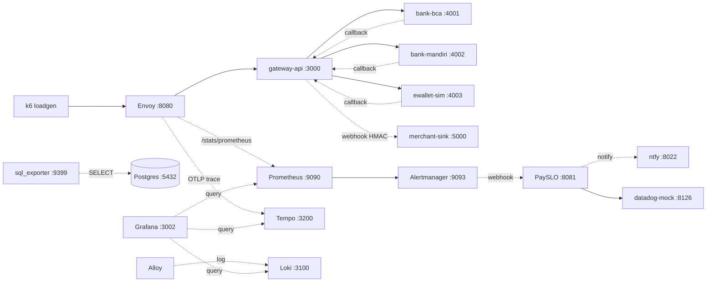
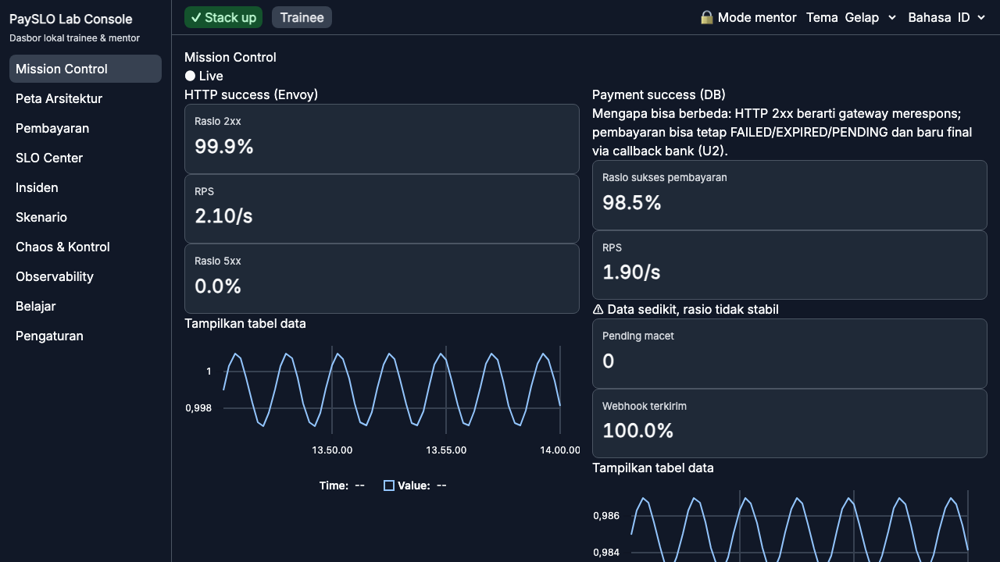

# PaySLO Lab

Lab simulasi payment gateway 100% lokal (Docker Compose) untuk onboarding SRE,
sekaligus lingkungan uji tool open source **PaySLO** (SLO-as-code multi-provider
+ incident management + runbook automation).

> ⚠️ **BUKAN UNTUK PRODUKSI.** Lab ini hanya untuk laptop lokal.
> Semua port di-bind ke `127.0.0.1`, semua kredensial bertanda `lab-only`,
> semua data sintetis. Tidak ada auth kelas produksi, tidak ada Kubernetes,
> tidak ada cloud, tidak ada Datadog asli (`datadog-mock` hanya tiruan perilaku).
> Jangan jalankan di server publik, jangan isi data asli, jangan expose port.

> 📖 **Panduan langkah demi langkah dari nol** (prasyarat → stack → Lab Console →
> skenario → smoke → stop): [`docs/RUNNING.md`](docs/RUNNING.md).

## Quickstart 5 menit (jalur prebuilt — tanpa kompilasi)

Tiga perintah (butuh Docker Compose v2 + `make`):

```sh
PAYSLO_IMAGE_TAG=v0.1.0 make up-prebuilt
make e2e        # cek dasar: 1 pembayaran -> callback -> webhook via Envoy
make down
```

Trainee (setelah stack up) — jalur CLI:

```sh
cargo run -p lab -- scenario start 01   # atau: ./target/debug/lab scenario start 01
# ... deteksi via alert, mitigasi via: lab routing disable bca ...
cargo run -p lab -- verify 01
cargo run -p lab -- scenario stop 01
```

Trainee — jalur **Lab Console** (UI web, tanpa CLI, lihat
[Lab Console](#lab-console-u0u8)):

```sh
make up-lite    # atau: PAYSLO_IMAGE_TAG=v0.1.0 make up-prebuilt
make ui-build   # sekali; UI di-embed ke binary `lab serve`
make serve      # buka http://127.0.0.1:8088
```

Kemudian: buat pembayaran di **Pembayaran**, pantau **Insiden** (alert → runbook →
approval). Menjalankan/memverifikasi skenario kurikulum masih lewat CLI `lab`
(rute `/scenarios` di UI masih placeholder — lihat `docs/BACKLOG.md`).

Kontributor Rust (jalur build lokal):

```sh
make up-lite    # build lokal + up default+traffic+obs+payslo
make smoke      # pipeline penuh (up -> traffic -> apply SLO ->
                # solver 01 -> incident + ntfy + resolved -> down;
                # ~12-75 mnt tergantung drain burn 1h)
make down
```

> Catatan: image prebuilt terbit per tag git (`v*`) via workflow `release.yml`
> ke GHCR. Fork WAJIB menimpa registry: `PAYSLO_REGISTRY=ghcr.io/<org> make
> up-prebuilt` (lihat `docs/VERSIONS.md`). Tag default `v0.1.0`.

## Arsitektur



Alur uang (P2): HTTP 200 dari gateway TIDAK berarti pembayaran sukses —
status final (SUCCESS/FAILED/EXPIRED) datang via callback bank.

## Daftar URL (semua `127.0.0.1`, lihat `make open`)

| Layanan | URL | Kredensial |
|---|---|---|
| gateway-api | :3000/healthz, :3000/readyz | — |
| gateway admin | :3001 (loopback-only, tidak lewat Envoy) | — |
| Envoy | :8080 (trafik), :9901 (admin/stats) | — |
| merchant-sink | :5000/state | — |
| bank-sim | :4001 (bca), :4002 (mandiri), :4003 (ewallet) | — |
| Prometheus | :9090 | — |
| Alertmanager | :9093 | — |
| Grafana | :3002 | admin / `lab-only-grafana` (anonim=Viewer) |
| sql_exporter | :9399/metrics | via role DB `lab_ro` (read-only) |
| Loki | :3100 | — |
| Tempo | :3200 | — |
| PaySLO | :8081/incidents | — |
| datadog-mock | :8126 | header `DD-API-KEY` (nilai lab) |
| ntfy (topik) | :8022/payslo-lab | tanpa auth (lab-only, loopback saja!) |

## Kebutuhan resource

- Laptop 4 CPU / 8 GB RAM; Linux/macOS/Windows-WSL2; amd64 dan arm64.
- Profil `up-lite` (diukur 2026-10-15, `docker stats --no-stream`, arm64):

| Service | RAM pakai / limit |
|---|---|
| postgres | ~56 MB / 256 MB |
| prometheus | ~58 MB / 256 MB |
| grafana | ~73 MB / 256 MB |
| envoy | ~17 MB / 128 MB |
| sql-exporter | ~17 MB / 64 MB |
| alertmanager | ~27 MB / 64 MB |
| ntfy | ~14 MB / 64 MB |
| loadgen (k6) | ~11 MB / 128 MB |
| gateway-api | ~2 MB / 128 MB |
| bank-sim ×3 | ~1 MB / 64 MB tiap |
| merchant-sink | ~2.5 MB / 64 MB |
| payslo | ~1 MB / 128 MB |
| datadog-mock | ~1 MB / 64 MB |
| **Total up-lite** | **~280 MB** (jauh di bawah batas 5 GB, P6) |
| + obs-full (loki ~45 MB, tempo ≤384 MB, alloy) | ~+200 MB bila diaktifkan |

- Ukuran image Rust (musl statis, `scratch`, diukur 2026-10-15 arm64):
  gateway-api 14.5 MB, bank-sim 11.3 MB, merchant-sink 5.2 MB,
  payslo 19.3 MB, datadog-mock 5.4 MB. ntfy (upstream) 118 MB.

## Waktu build + panduan memori 8 GB

Diukur 2026-10-14 (colima 4CPU/8GB arm64); Dockerfile tidak berubah di FASE 8.

| Skenario | Waktu |
|---|---|
| Build bersih (cold cache, semua deps musl release) | ± 7 mnt |
| Incremental (1 file Rust berubah, cache chef) | ± 50 dtk |
| Tanpa perubahan (full cache) | ± 1 dtk |

- `Dockerfile` memakai `cargo-chef` (planner → cacher → builder) + SATU stage
  builder (`cargo build --release --workspace`), lalu stage runtime per binary.
- `CARGO_BUILD_JOBS=2` di-set di `Dockerfile` (env) agar tidak OOM di 8 GB.
  Jangan naikkan di laptop 8 GB; di CI 16 GB boleh `CARGO_BUILD_JOBS=4`.
  Contoh: `CARGO_BUILD_JOBS=2 docker compose --profile traffic --profile obs --profile payslo up -d --build`.
- Beri Docker Desktop/Colima ≥ 6 GB bila build + stack jalan bersamaan.
- CI memakai `Swatinem/rust-cache` (cargo) + `cache-from/to: type=gha`
  (lapisan Docker) agar build incremental.

## Profil compose

| Profil | Isi | Perintah |
|---|---|---|
| (default) | postgres, gateway-api, 3× bank-sim, merchant-sink, envoy | selalu ikut |
| traffic | loadgen (k6) | `make up-lite` |
| obs | prometheus, alertmanager, sql-exporter, grafana | `make up-lite` |
| obs-full | loki, tempo, alloy | `make up-obs-full` / `make up` |
| payslo | payslo, datadog-mock, ntfy | `make up-lite` |

- `make up-lite` = default+traffic+obs+payslo (build lokal).
- `make up-prebuilt` = sama, image GHCR ber-tag versi (tanpa build).
- `make up` = semua profil. Semua service punya healthcheck (kecuali envoy,
  ntfy, payslo — image tanpa shell; kesiapan dicek via HTTP oleh smoke) dan
  `depends_on` yang relevan. Semua port host `127.0.0.1`.
- `make reset` = `down -v` + `up-lite` (data sintetis dibuat ulang).
  Idempotent: `make up-lite` dua kali tidak error.

## Perintah utama

```sh
make help       # semua target
make build      # cargo build --workspace
make lint       # fmt --check + clippy -D warnings
make test       # cargo test --workspace
make deny       # cargo deny check
make status     # status container
make open       # daftar URL
make smoke      # pipeline penuh FASE 8 (~75 mnt)
make e2e        # cek dasar cepat (~30 dtk)
```

## Lab Console (U0–U8)

Dashboard web lokal di `127.0.0.1:8088` (Go `lab serve` + React embed):



> Tangkapan layar Mission Control (`lab serve --demo`, tema gelap). Snapshot
> lengkap semua halaman (2 tema) ada di `ui/e2e/visual.spec.ts-snapshots/`.

```sh
make ui-install   # npm ci (pin eksak)
make ui-dev       # Vite :5173 (dengan --dev-proxy untuk API)
make ui-build     # tsc + vite -> ui/dist (+ salin ke embed Go)
make ui-test      # tsc + eslint + vitest + prettier-check
make ui-e2e       # Playwright vs lab serve --demo (axe + a11y + visual + keamanan)
make ui-audit     # npm audit + lisensi + anggaran bundle + gofmt/go vet
make ui-perf      # anggaran bundle + FCP/DCL (PERF_SOAK_SECONDS untuk soak SSE)
make serve        # API live + UI embed di :8088
make serve-demo   # fixture deterministik, tanpa Docker
```

Halaman: **Mission Control**, Peta Arsitektur, **Pembayaran**, **Chaos & Kontrol**,
**SLO Center**, **Insiden**, **Mentor** (PIN), **Belajar** (kurikulum), **Observability**
(Grafana/Prometheus/Alertmanager/ntfy), **Pengaturan & Diagnostik**. Sisanya placeholder.
Trainee hanya bicara ke `lab serve`; mutasi butuh `X-Lab-Token` + `X-Lab-Actor` dan
tercatat di `payslo-workspace/lab-audit.jsonl` (append-only). Operasi SLO live butuh
`DD_API_KEY=lab-only-dd-api-key` di host (`make serve`) untuk koneksi datadog-mock.
Fitur aksesibilitas (U8): keyboard-only penuh, `aria-live` untuk insiden/approval,
dukungan `prefers-reduced-motion`, dan zoom 200% tanpa overflow.

Standar kualitas UI (U8) diverifikasi di CI (`.github/workflows/ci.yml`) dan lokal:
`tsc --noEmit` strict, ESLint (jsx-a11y + larangan string hardcoded), Prettier, Vitest
(coverage logika inti ≥ 80%), Playwright (a11y/axe, visual regression, kompatibilitas,
keamanan), `npm audit` + pemeriksaan lisensi (`ui/scripts/check-licenses.mjs`), serta
anggaran bundle (`ui/scripts/check-bundle.mjs`: JS initial ≤ 350 KB gzip).
Angka hasil ukur (bundle, FCP/DCL, soak SSE 1 jam, matriks axe) ada di `docs/UI-SPEC.md`.

Kontrak API: `api/openapi.yaml` (contract-first; tipe TS di-generate ke
`ui/src/api/`). Spesifikasi UI: `docs/UI-SPEC.md`.

## PaySLO CLI

```sh
cargo run -p payslo-cli -- validate payslo-workspace/slo --workspace payslo-workspace
cargo run -p payslo-cli -- render payslo-workspace/slo --workspace payslo-workspace --out payslo-workspace/generated
cargo run -p payslo-cli -- plan payslo-workspace/slo --workspace payslo-workspace
export DD_API_KEY=lab-only-dd-api-key
cargo run -p payslo-cli -- apply payslo-workspace/slo --workspace payslo-workspace
cargo run -p payslo-cli -- drift --workspace payslo-workspace
cargo run -p payslo-cli -- capabilities
```

Template di `payslo/templates/` (3 lab + 1 contoh produksi 30d, render-only).
Koneksi di `payslo-workspace/connections.yml`. Matriks kapabilitas:
`payslo/CAPABILITIES.md`.

## Lab trainee

```sh
cargo run -p lab -- scenario list
cargo run -p lab -- scenario start 01
cargo run -p lab -- hint 01
cargo run -p lab -- routing disable bca
cargo run -p lab -- answer diagnosis "provider bca down ..."
cargo run -p lab -- verify 01
cargo run -p lab -- scenario stop 01
```

Kurikulum 5 hari: [curriculum/](curriculum/). Panduan mentor:
[docs/mentor-guide.md](docs/mentor-guide.md). Bila macet:
[docs/troubleshooting.md](docs/troubleshooting.md). Pin versi + cara upgrade:
[docs/VERSIONS.md](docs/VERSIONS.md). Isu pemula:
[docs/GOOD_FIRST_ISSUES.md](docs/GOOD_FIRST_ISSUES.md).

## FAQ

**Berapa lama smoke?** `make e2e` ~30 dtk. `make smoke` ~12-75 mnt
(solver 8 mnt + menunggu burn 1h/10m reda; terukur 698 dtk pada 2026-10-15
untuk periode buruk pendek, hingga ~1 jam untuk periode panjang).

**Verify PASS tapi insiden masih open?** Wajar: page alert reda dulu (~5-15 mnt),
ticket 1h/10m terakhir (~1 jam). Lihat `docs/troubleshooting.md`.

**`verify 01` PASS tanpa aksi?** Tidak seharusnya; bila terjadi dengan insiden
lama, laporkan (draf isu no. 4 di `docs/GOOD_FIRST_ISSUES.md`).

**Apple Silicon vs Intel?** Keduanya didukung (musl statis, buildx
amd64+arm64). Ukuran image di atas diukur di arm64; amd64 seorde sama.

**Data saya aman?** Semua sintetis. Jangan isi data asli. Lihat peringatan di atas.

**Boleh dipakai produksi?** TIDAK. Lihat peringatan paling atas.

## Aturan main

Baca `AGENTS.MD` (peran, tech stack, prinsip P1–P8) dan `CONTRIBUTING.md` (DCO sign-off).
Keputusan desain: `docs/DECISIONS.md`. Asumsi belum terverifikasi: `docs/ASSUMPTIONS.md`.
Changelog: `CHANGELOG.md`.

## Lisensi

Apache-2.0 — lihat `LICENSE`.
